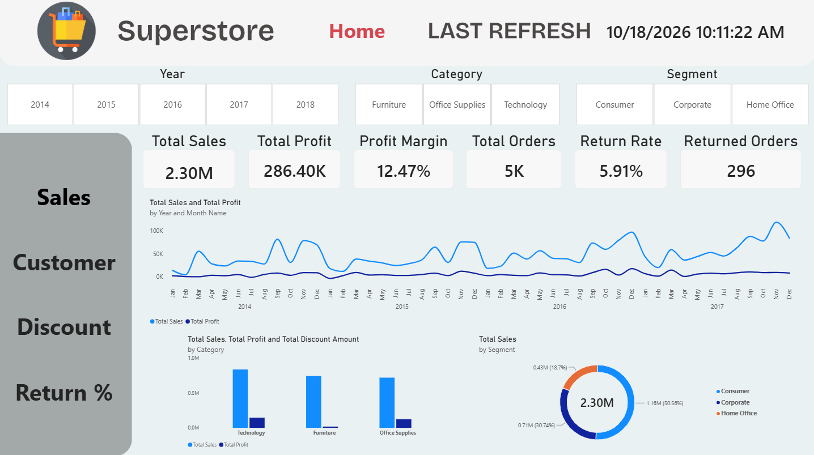
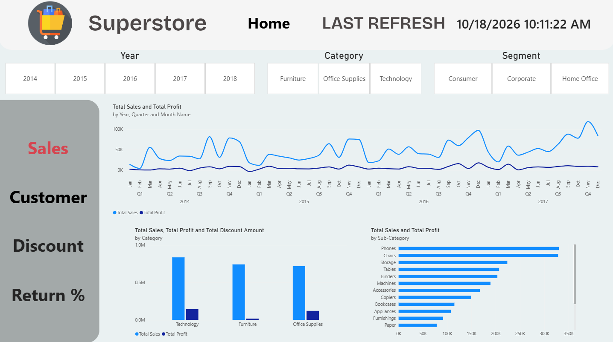
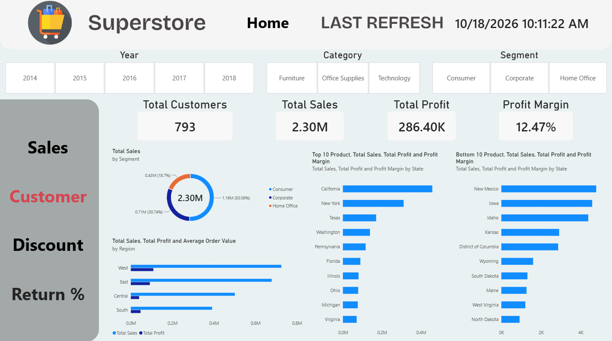
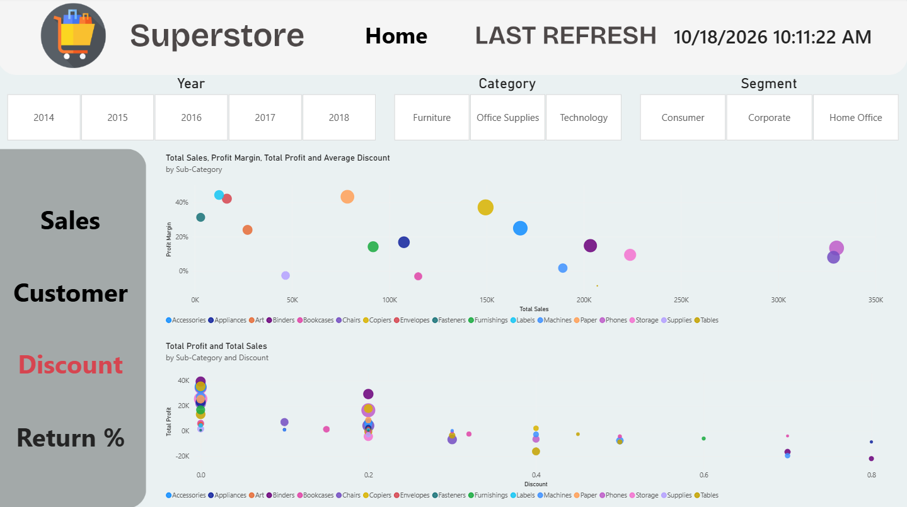
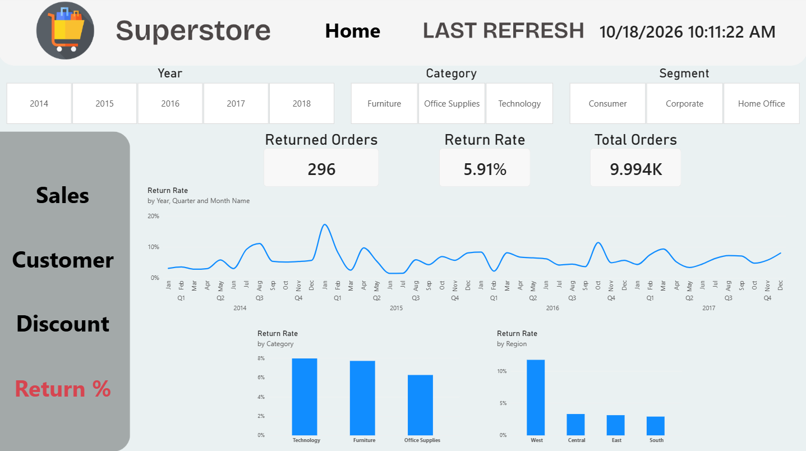

# Superstore Sales & Profit Analysis | Power BI


**An End-to-End Business Intelligence Project**


A retail analytics project built with Microsoft Power BI to explore sales performance, profitability, customer behavior, product trends, regional performance, discount strategies, and returned orders.


## 📌 Project Overview


This project analyzes the Superstore retail dataset to transform transactional data into meaningful business insights. It follows a structured Business Intelligence workflow, covering data profiling, data preparation, dimensional modeling, DAX measure development, and business analysis.


The goal is to identify performance trends, understand the factors affecting profitability, and support data-driven business decisions through measurable KPIs and interactive dashboard reports.


### Key Performance Indicators


| KPI | Result |

|---|---:|

| Total Sales | 2.30M |

| Total Profit | 286.40K |

| Total Orders | 5,009 |

| Total Customers | 793 |

| Total Products | 1,862 |

| Returned Orders | 296 |

| Return Rate | 5.91% |


## 🖼️ Dashboard Preview


The `Images` folder is located alongside this README file and contains five dashboard screenshots and one data model image.


### Dashboard Reports


**Dashboard Report 1**





**Dashboard Report 2**





**Dashboard Report 3**





**Dashboard Report 4**





**Dashboard Report 5**





### Data Model


The data model illustrates the fact and dimension tables designed to support analytical reporting.


## 🎯 Business Objectives


The project addresses the following business objectives:


- Evaluate overall sales, profit, and quantity performance.

- Analyze sales and profit trends over time.

- Identify the highest-performing product categories and sub-categories.

- Compare sales and profitability across regions and states.

- Evaluate performance across customer segments.

- Investigate the relationship between discount levels and profitability.

- Measure returned orders and the overall return rate.

- Identify products and regions with high sales but relatively low profitability.

- Support business decisions through KPIs and time-based comparisons.


## 🛠️ Tools & Technologies


| Technology | Application |

|---|---|

| Microsoft Power BI | Data modeling, measures, and dashboard reporting |

| Power Query | Data profiling, transformation, and preparation |

| DAX | KPI calculations and time intelligence |

| Dimensional Data Modeling | Fact and dimension table design |

| GitHub | Project documentation and portfolio presentation |


## 📂 Dataset Overview


The dataset contains retail transactions from the United States, covering orders placed between January 2014 and December 2017.


### Source Tables


#### 1. Orders


The primary transactional dataset contains 9,994 rows. Each row represents an order line rather than necessarily a unique order.


| Metric | Result |

|---|---:|

| Total Rows | 9,994 |

| Distinct Order IDs | 5,009 |

| Distinct Customer IDs | 793 |

| Distinct Product IDs | 1,862 |

| Earliest Order Date | 2014-01-03 |

| Latest Order Date | 2017-12-30 |

| Earliest Ship Date | 2014-01-07 |

| Latest Ship Date | 2018-01-05 |


The dataset includes sales, profit, quantity, discount, customer, product, shipping, and geographic attributes.


#### 2. Returns


Contains the `Returned` status and `Order ID` fields. It is used to identify returned orders and associate return information with the relevant transactions.


#### 3. People


Contains four records mapping individuals to regions. Because the table provides no additional transactional or analytical attributes and its intended relationship to the core model is unclear, it was excluded from the analytical model and retained for documentation purposes.


### Dataset Characteristics


- Country: United States

- Regions: West, East, Central, South

- Customer segments: Consumer, Corporate, Home Office

- Product categories: Furniture, Office Supplies, Technology

- Shipping modes: Standard Class, Second Class, First Class, Same Day


## 🔄 Data Preparation & Quality Assessment


Data profiling and initial preparation were performed using Power Query.


### Activities Performed


- Reviewed data types for suitability.

- Checked for missing and blank values.

- Checked for data errors.

- Reviewed distinct identifiers and record counts.

- Promoted the first rows to headers in the `Returns` and `People` queries.

- Preserved repeated `Order ID` values because an order can contain multiple product-level records.

- Removed the redundant `Orders\&FilterDatabase` query.

- Retained `Orders`, `Returns`, and `People` as the source queries.


### Initial Data Quality Results


| Check | Result |

|---|---|

| Missing or blank values | None identified |

| Data-type issues | None identified |

| Data errors | None identified |

| Duplicate removal on Order ID | Not performed |

| Redundant query | Removed |


The initial profiling did not identify issues that prevented progression to the data modeling stage.


**Scope note:** These results reflect the initial Power Query profiling and do not independently establish that every transformation or relationship in the final model has been validated.


## 🧩 Data Modeling & Relationships


The analytical model is designed around a central fact table supported by descriptive dimension tables.


### Model Components


**Fact Table**


- `Fact Orders` — the central table containing order-line records and transactional information.


**Dimension Tables**


- `Dim Customer` — customer identifiers and customer segments.

- `Dim Product` — product attributes, categories, and sub-categories.

- `Dim Location` — geographic attributes, including region, state, and city.

- `Dim Ship Mode` — shipping method attributes.

- `Dim Date` — calendar attributes for time-based analysis.


**Supporting Table**


- `Returns` — return status information associated with orders.


### Relationship Design


| Relationship | Cardinality | Configuration |

|---|---|---|

| Dim Customer → Fact Orders | 1:\* | One-to-many |

| Dim Product → Fact Orders | 1:\* | One-to-many |

| Dim Location → Fact Orders | 1:\* | One-to-many |

| Dim Ship Mode → Fact Orders | 1:\* | One-to-many |

| Dim Date → Fact Orders via Order Date | 1:\* | Active |

| Dim Date → Fact Orders via Ship Date | 1:\* | Inactive |

| Returns → Fact Orders via Order ID | 1:\* | Intended one-to-many relationship |

| People | — | No relationship in the current design |


### Modeling Principles


- Use a central fact table supported by descriptive dimensions.

- Apply single-direction filtering from dimensions to the fact table.

- Use the active order-date relationship for standard time-based analysis.

- Use the inactive ship-date relationship when shipping-date analysis is required.

- Avoid unintended many-to-many relationships.

- Preserve the expected fact-table row count during data preparation and merging.

- Keep source queries separate from the fields exposed to report consumers where appropriate.


The `Orders Source` query is intended to be hidden from report consumers if it is retained in the model.


**Validation note:** The relationships above document the intended design. Their actual cardinalities, filter directions, active status, key uniqueness, and row-count preservation should be verified in the Power BI model.


## 📐 DAX Measures


The project includes measures for performance reporting, customer analysis, discount evaluation, returned orders, and year-over-year comparisons.


### Core Performance Measures


- `Total Sales`

- `Total Profit`

- `Total Quantity`


### Business Activity Measures


- `Total Orders`

- `Total Customers`

- `Total Products`

- `Profit Margin`


### Discount & Returns Measures


- `Returned Orders`

- `Return Rate`

- `Average Order Value`

- `Average Discount`

- `Total Discount Amount`


### Time Intelligence Measures


- `Sales Previous Year`

- `Profit Previous Year`

- `Sales YoY %`

- `Profit YoY %`


These measures support the evaluation of business performance across time, products, customer segments, and geographic locations.


*Note: The measure names are documented from the supplied project notes. Their exact DAX definitions and calculation conventions should be reviewed in the Power BI file.*


## 📊 Business Questions & Key Findings


### 1. What Are the Total Sales and Profit?


The business generated:


- **Total Sales:** 2.30M

- **Total Profit:** 286.40K


These KPIs provide a baseline for assessing overall performance and comparing results across products, regions, and customer segments.


### 2. How Do Sales and Profit Change Over Time?


The monthly analysis reveals recurring seasonal patterns alongside year-specific variations.


Key observations include:


- January and February generally show weaker profitability, with February frequently recording the lowest monthly profit.

- Performance generally strengthens toward the end of the year.

- September through December is typically a strong period for sales and profitability.

- October frequently interrupts the late-year upward trend.

- November often performs strongly, although the peak profit month varies by year.

- In the final year of the analyzed period, monthly results were relatively consistent, with March standing out as a particularly strong profit month.


These patterns highlight the value of analyzing monthly performance over multiple years rather than relying on a single annual trend.


### 3. Which Categories and Sub-Categories Generate the Highest Sales and Profit?


Technology is the leading product category in both sales and profit, based on the supplied analysis.


| Metric | Result |

|---|---:|

| Technology Sales | 836,154.03 |

| Technology Profit | 145,454.95 |

| Highest-Selling Sub-Category | Phones |

| Phones Sales | 330,007.05 |

| Most Profitable Sub-Category | Copiers |

| Copiers Profit | 55,617.82 |


Phones are a major contributor to sales, while Copiers lead in sub-category profitability. This demonstrates that the highest-selling products are not necessarily the most profitable.


### 4. What Is the Sales and Profit Performance by Region and State?


#### Regional Performance


| Region | Sales | Profit | Profit Margin |

|---|---:|---:|---:|

| West | 725.46K | 108.42K | 14.94% |

| East | — | — | 13.48% |

| South | — | — | 11.93% |

| Central | 501.24K | 39.71K | 7.92% |


The West leads in sales and profit, while the Central region has the lowest profit margin among the four regions.


The South is the correct fourth regional label in the dataset; it is used consistently throughout this documentation.


#### State-Level Performance


- California leads in sales at approximately 457.69K and profit at approximately 76.38K.

- New York is another leading state in sales and profitability.

- Texas is a major contributor to sales, although strong sales do not necessarily translate into strong profit.

- New Mexico records the lowest sales at approximately 4.78K.

- Iowa records the lowest profit at approximately 1.18K.


These findings illustrate the importance of comparing sales and profit independently when evaluating geographic performance.


### 5. How Does Performance Vary Across Customer Segments?


| Customer Segment | Sales | Profit | Share of Total Profit | Customers |

|---|---:|---:|---:|---:|

| Consumer | 1.16M | 134.12K | 50.56% | 409 |

| Corporate | — | — | 30.74% | 236 |

| Home Office | — | — | 18.70% | 148 |


The Consumer segment is the largest contributor to sales and profit, accounting for approximately half of total profit.


Corporate ranks second in contribution to total profit, followed by Home Office. These results provide a basis for comparing customer groups and identifying opportunities for targeted sales strategies.


### 6. What Is the Impact of Discounts on Profit?


The analysis indicates that higher discounts are associated with significant profitability challenges in several product sub-categories.


Key findings:


- The 0 discount level accounts for the highest volume of sub-category sales and shows no losses in the supplied analysis.

- At the 0.2 discount level, loss-making sub-categories are less prevalent.

- The 0.4 discount level includes some of the most significant losses.

- Losses also occur at the 0.6 discount level.

- At the 0.8 discount level, Appliances and Binders record losses of approximately 8,629 and 21,909, respectively.


These findings suggest that discount strategies should be evaluated against their impact on profit rather than sales volume alone.


### 7. What Percentage and Number of Orders Are Returned?


| KPI | Result |

|---|---:|

| Returned Orders | 296 |

| Return Rate | 5.91% |


Returned orders account for a measurable share of total order activity. Monitoring this KPI can help identify opportunities to improve product quality, order fulfillment, and customer satisfaction.


### 8. Which Products or Regions Have High Sales but Low Profitability?


#### Central Region


- Sales: 501.24K

- Profit: 39.71K

- Profit Margin: 7.92%


The Central region generates substantial sales but has a comparatively low profit margin, indicating a potential opportunity to review pricing, discounting, and product mix.


#### Product-Level Example


**Cisco TelePresence System EX90 Videoconferencing Unit**


- Sales: 22.64K

- Profit: -1.81K


This product generates revenue while recording a loss, illustrating why sales alone are not a sufficient measure of product performance.


#### Furniture Category


- Sales: Approximately 741,999

- Profit: Approximately 18,451


Furniture generates substantial revenue but comparatively limited profit, making it an important category for further profitability analysis.


## 💡 Key Business Insights


The analysis highlights several opportunities for better-informed business decisions:


1. **Prioritize profitable growth:** Technology and the West region are major contributors to overall profitability.

2. **Investigate low-margin regions:** The Central region generates considerable sales but has a comparatively low profit margin.

3. **Review discount policies:** Higher discounts coincide with losses in several product sub-categories.

4. **Monitor product-level profitability:** Products with high sales can still generate losses.

5. **Account for seasonality:** Late-year performance is generally strong, making monthly trend analysis useful for planning.

6. **Understand customer contributions:** The Consumer segment accounts for approximately 50.56% of total profit.

7. **Track returns:** The 5.91% return rate provides a baseline for monitoring operational performance.


## 📋 Project Workflow


The project follows a structured Business Intelligence workflow:


1. **Data Profiling** — Inspecting tables, columns, identifiers, date ranges, and data quality.

2. **Data Preparation** — Reviewing data types, headers, and redundant queries in Power Query.

3. **Data Modeling** — Designing fact and dimension tables and defining relationships.

4. **DAX Development** — Defining measures for KPIs, profitability, discounts, returns, and time intelligence.

5. **Business Analysis** — Evaluating performance across products, regions, customers, and time.

6. **Dashboard Reporting** — Presenting analytical findings through five dashboard report screenshots.


## 📁 Repository Structure


The repository is organized as follows:


```text

Superstore-Sales-Profit-Analysis/

│

├── README.md

│

└── Images/

   ├── Dashboard-Report_1.png

   ├── Dashboard-Report_2.png

   ├── Dashboard-Report_3.png

   ├── Dashboard-Report_4.png

   ├── Dashboard-Report_5.png

   └── Data Model.png

```


The `Images` folder is located in the same directory as `README.md`.


- `Dashboard-Report_1.png` to `Dashboard-Report_5.png` contain the five dashboard report screenshots.

- `Data Model.png` contains the data model diagram.


The README references these files using relative paths so the images can be displayed directly on GitHub when the folder and filenames match the repository structure.


## ✅ Validation Checklist


The following checklist identifies the main validation items for the analytical model.


- [x] Initial Power Query profiling documented.

- [x] Source tables identified and documented.

- [x] Redundant query identified and removed.

- [x] Initial data quality checks recorded.

- [x] Required DAX measures identified.

- [x] Business questions and findings documented.

- [x] Verify relationship cardinalities and filter directions.

- [x] Verify active and inactive date relationships.

- [x] Confirm fact-table row counts after merges.

- [x] Validate DAX measures against independent calculations.

- [x] Reconcile all reported totals with the final Power BI report.


## 🏁 Conclusion


The Superstore Sales \& Profit Analysis project demonstrates a structured approach to retail Business Intelligence using Power BI, Power Query, and DAX.


By combining data preparation, dimensional modeling, KPI development, and business analysis, the project identifies meaningful differences in profitability across products, regions, customer segments, and discount levels.


The findings show that revenue growth alone does not guarantee profitability. Discount management, product-level margins, geographic performance, seasonal trends, and returned orders all contribute to a more complete understanding of business performance.


This analytical framework supports more informed decisions around pricing, product selection, discount strategies, regional performance, and customer management.


\---


**Project:** Superstore Sales & Profit Analysis  

**Primary Tool:** Microsoft Power BI  

**Data Preparation:** Power Query  

**Analytical Language:** DAX  

**Dataset:** Superstore Retail Transactions

**Data Source:** [Kaggle – Superstore Dataset](https://www.kaggle.com/datasets/divyjn28/superstore-dataset)

**Order Period:** 2014–2017  

**Key Focus Areas:** Sales, Profitability, Products, Customers, Regions, Discounts, Returns, and Time Intelligence


